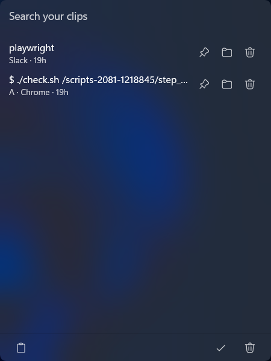
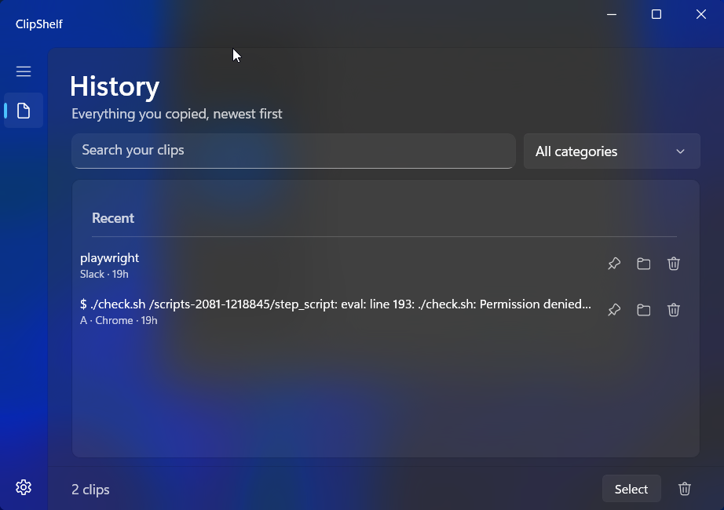
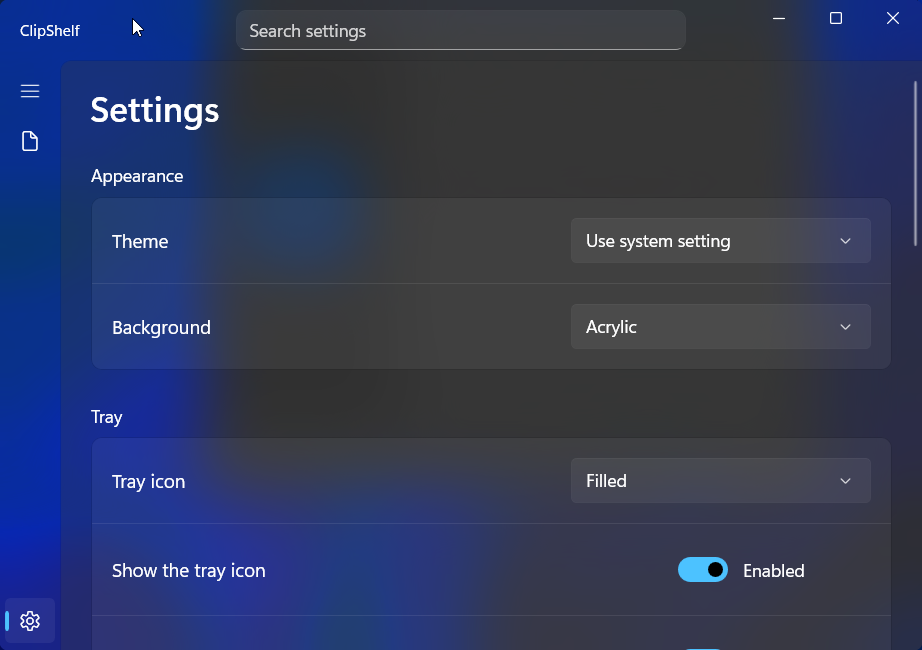
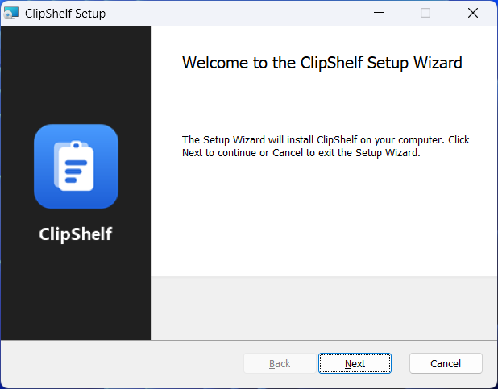

# Copyloft

Copyloft is a clipboard-history app for Windows, Linux and macOS that keeps recently copied text searchable and ready to paste from a floating flyout or the system tray.

## Contents

- [Screenshots](#screenshots)
- [Features](#features)
- [Performance](#performance)
- [Requirements](#requirements)
- [Installing on Linux](#installing-on-linux)
- [Installing on macOS](#installing-on-macos)
- [Scripts](#scripts)
- [Project structure](#project-structure)
- [Data locations](#data-locations)
- [Localization](#localization)
- [Contributing](#contributing)
- [Releases](#releases)
- [Built with](#built-with)
- [License](#license)

## Screenshots

Show screenshots

The clipboard flyout opens next to the mouse pointer; pick a clip to paste it into the app you came from.

The full history window: search, categories, pinned and recent clips, multi-select copy.

Settings: themes and background, the tray, behavior, history, export and category locks.

The installer wizard, with the MIT license, install location and finish-page options.

## Features

**Capture and history**
- Capture copied text into a local SQLite history; re-copying a clip moves it to the top instead of duplicating it.
- Copied images are kept alongside text, shown as thumbnails, and paste back as images (multi-copy and export cover text clips).
- Browse the full history in its own window, grouped into Pinned and Recent, with readable app names ("Chrome", "Word") and relative times.
- Search the history, pin clips, delete single clips, or clear everything unpinned; a placeholder explains an empty history, an empty search and an empty category.

**The flyout**
- Open the floating flyout with `Win+Shift+V` (`Cmd+Shift+V` on a Mac) or a single tray click; it appears next to the mouse pointer and closes when you click anywhere else.
- Pick a clip to copy it and paste it into the app you came from; the Up and Down arrows move through the clips, Enter pastes the selected one, and Ctrl+1 to Ctrl+9 paste one of the first nine.
- Select several clips and copy them together as one multi-line text.

**Categories**
- Save clips into named categories from the folder button on any row; create a category on the spot, and rename or delete them in Settings.
- Filter the full history by category; categorized clips are kept out of Clear, the history limit and retention.
- Lock a category to hide its clips from the history, the flyout, search and exports; opening it asks for the password.
- Choose when locks return: on exit, on minimize, or on shutdown or sign-out.

**Export**
- Export the text history to JSON or CSV from Settings, including each clip's category.
- One password (stored only as a salted hash) guards exporting and locked categories.

**Appearance**
- Themes: System, Light (soft light surfaces), Dark and Full black.
- Backgrounds on Windows: Mica, Acrylic or solid (Mica Alt shows as Mica).

**Tray and behavior**
- Filled or outline tray icon, hide the tray icon, and choose whether a tray double-click opens the full history.
- Record a new global shortcut, run at startup (sign-in on Linux, login on macOS), cap the history size, and set retention (1 day, 7 days, 30 days or forever).
- Optionally clear unpinned history when you sign out or shut down; a search box in the title bar finds any setting.
- Check for a newer release from Settings; Copyloft looks once per run and links to the download.
- A welcome window on the first run explains the hotkey and that Copyloft lives in the tray.
- A start that fails (for example a denied keyring or Keychain request) says why in a small window and names the log folder.

**Privacy**
- The history database is SQLCipher-encrypted with a random key protected for your account: Windows DPAPI, the Secret Service keyring on Linux, the Keychain on macOS.
- Temporary storage stays in memory, freed memory is scrubbed, and a test proves the database, its sidecars and backups contain no readable clip text.
- Start in the tray and keep history and settings on this computer (see [Data locations](#data-locations)).

The default shortcut is `Win+Shift+V` (`Cmd+Shift+V` on a Mac); change it in Settings if another app has already registered it.

## Performance

Load-tested through the real encrypted storage pipeline; details and numbers in [docs/performance.md](docs/performance.md):

- 10,000 clips insert in about 2 seconds (~0.2 ms per copy), and the flyout's first page stays under a millisecond.
- Trimming the history to the limit costs a partial-index seek proportional to the limit; a million stored clips no longer slow captures down (7.6 s per copy before the fix, about 1 ms after).
- Search stays within a few milliseconds at the 1,000-item Settings maximum; storage is about 0.43 KB per text clip.

## Requirements

- Windows 10 version 1809 or later, or Windows 11 (x64)
- Linux x64 with an X11 or Wayland session (XWayland); the packages list their libraries
- macOS 15 or later, Apple Silicon or Intel
- For development: the .NET 10 SDK version pinned in `global.json`

## Installing on Linux

Download from the [releases](https://github.com/ai94iq/Copyloft/releases):

- Debian and Ubuntu: `sudo apt install ./copyloft_<version>_amd64.deb`
- Fedora and openSUSE: `sudo dnf install ./copyloft-<version>-1.x86_64.rpm`
- Anything else: unpack `copyloft-<version>-linux-x64.tar.gz` and run `Copyloft` from it

The packages install to `/opt/copyloft` with a `copyloft` command and a menu entry.

Desktop differences (details in [docs/known-issues.md](docs/known-issues.md) and [ADR 0007](docs/decisions/0007-linux-platform.md)):

- Wayland sessions: the shortcut only works while Copyloft has focus, so bind a system shortcut to `copyloft --toggle`; a picked clip is copied and you press Ctrl+V yourself.
- GNOME shows the tray icon only with the AppIndicator extension; without a tray, History opens at launch.
- Without a keyring service the database key is kept in a file only your user can read.

## Installing on macOS

Download `Copyloft-<version>-macos-arm64.dmg` (Apple Silicon) or `-macos-x64.dmg` (Intel) from the [releases](https://github.com/ai94iq/Copyloft/releases) and drag Copyloft to Applications.

The app is not notarized (there is no Apple Developer ID), so macOS blocks the first launch. Open System Settings > Privacy & Security and choose Open Anyway for Copyloft, or run `xattr -dr com.apple.quarantine /Applications/Copyloft.app` once.

Copyloft lives in the menu bar. While its History or Settings window is open it also shows its own menu next to the Apple menu and a Dock icon, like any app. The shortcut is Cmd+Shift+V. To paste a picked clip for you it needs the Accessibility permission, which macOS asks for the first time; without it a pick is copied and you press Cmd+V.

After an update macOS asks again for the login keychain password and for the Accessibility permission, because each release is signed ad hoc. Details: [docs/known-issues.md](docs/known-issues.md) and [ADR 0008](docs/decisions/0008-macos-platform.md).

## Scripts

| Script | Purpose |
|---|---|
| `run.bat` | Run the app in Debug (it starts in the notification area) |
| `build.bat` | Publish `Copyloft.exe` to `artifacts\publish\win-x64` |
| `test.bat` | Run all tests |
| `package.bat` | Test, build and create the MSI in `artifacts\installer` |
| `clean.bat` | Remove all build output |
| `build.sh`, `run.sh`, `clean.sh` | Linux and macOS twins of the .bat scripts (`build.sh` publishes for this machine's OS and CPU) |
| `test.sh` | Linux and macOS: run all tests (the X11 tests need a display; CI uses `xvfb-run`) |
| `package.sh` | Linux: tarball, `.deb` and `.rpm` in `artifacts/linux` (needs `dpkg-deb` and `rpmbuild`) |
| `package-macos.sh` | macOS: `Copyloft.app` and a `.dmg` per architecture in `artifacts/macos` |

Pass `--no-pause` to skip the final key press (used by automation).

A second launch never starts a second copy: `Copyloft.exe --toggle` (`copyloft --toggle` on Linux) toggles the flyout in the running instance and `--history` opens its history window.

## Project structure

| Project | Responsibility |
|---|---|
| `src/Copyloft.Desktop` | Avalonia 12 UI (Fluent theme), tray, clipboard flyout, the Windows, Linux and macOS platform layers, and app startup |
| `src/Copyloft.Presentation` | View models, portable services and the platform interfaces (net10.0) |
| `src/Copyloft.Core` | Domain models, interfaces, pure logic (no UI, no SQL) |
| `src/Copyloft.Data` | SQLite + Dapper repositories and numbered SQL migrations |
| `tests/*` | xUnit v3 tests per project |
| `installer` | WiX v6 MSI |
| `packaging/linux` | Desktop entry, icon and RPM spec for the Linux packages |
| `packaging/macos` | The app bundle's Info.plist |

Details: [docs/architecture.md](docs/architecture.md), the storage in [docs/database.md](docs/database.md), the visual rules in [DESIGN.md](DESIGN.md) and the product brief in [PRODUCT.md](PRODUCT.md).

## Data locations

All user data is in `%LOCALAPPDATA%\Copyloft\` on Windows, `~/.local/share/Copyloft/` on Linux and `~/Library/Application Support/Copyloft/` on macOS (an install from before the rename keeps its data: the first start moves the old `ClipShelf` folder here):

| Path | Contents |
|---|---|
| `data.db` | Local SQLite clipboard-history database (SQLCipher-encrypted) |
| `key.bin` | The database key, protected with Windows DPAPI for the current user; on Linux and macOS a marker for the key in the system keyring or Keychain, or the key itself (readable only by your user) without one |
| `backups\` | Automatic backups (newest 14) |
| `logs\` | Daily log files (newest 14) |
| `settings.json` | User settings |

Uninstalling keeps this folder. The history database is encrypted with SQLCipher; keep `key.bin` (and, on Linux and macOS, the keyring or Keychain entry it points to) together with `data.db`, since without the key the history cannot be read.

## Localization

English is the primary language; Arabic ships as a satellite and is selectable in Settings > Appearance > Language (a restart applies it). `Strings.resx` (English, neutral) and `Strings.ar.resx` keep matching keys. See [docs/localization.md](docs/localization.md).

## Contributing

- Commit title: `<project>: <type>: <short title>`, 60 characters at most, imperative, English. Projects: `desktop`, `presentation`, `core`, `data`, `tests`, `installer`, `docs`, `repo`. Types: `feat`, `fix`, `perf`, `refactor`, `test`, `docs`, `build`, `chore`, `i18n`, `style`.
- Commit body: what changed and why, wrapped at 72 characters.
- CI runs `test.bat` on Windows and `test.sh` on Ubuntu and macOS (where it also builds the app bundle) on every push and pull request, and publishes a GitHub release with the MSI, the Linux packages and the macOS disk images when a `vX.Y.Z` tag (matching `Version` in `Directory.Build.props`) is pushed.
- Before committing, `build.bat` and `test.bat` must pass, and the affected docs must be updated.
- Decisions: [docs/decisions](docs/decisions).

## Releases

Version is set in `Directory.Build.props`. Process: [docs/release.md](docs/release.md). History: [CHANGELOG.md](CHANGELOG.md). winget manifests: [packaging/winget](packaging/winget) (see [docs/winget.md](docs/winget.md)).

## Built with

This app follows [wpf-fluent-skill](https://github.com/ai94iq/wpf-fluent-skill), the agent skill that fixed the original stack (.NET 10, SQLite, WiX), the project layout and the UI rules. The UI moved from WinUI 3 to Avalonia 12 in October 2026 so Copyloft can follow to Linux and macOS.

## License

MIT; see [LICENSE](LICENSE). Bundled fonts are under the SIL Open Font License (`src/Copyloft.Desktop/Assets/Fonts/OFL.txt`).
